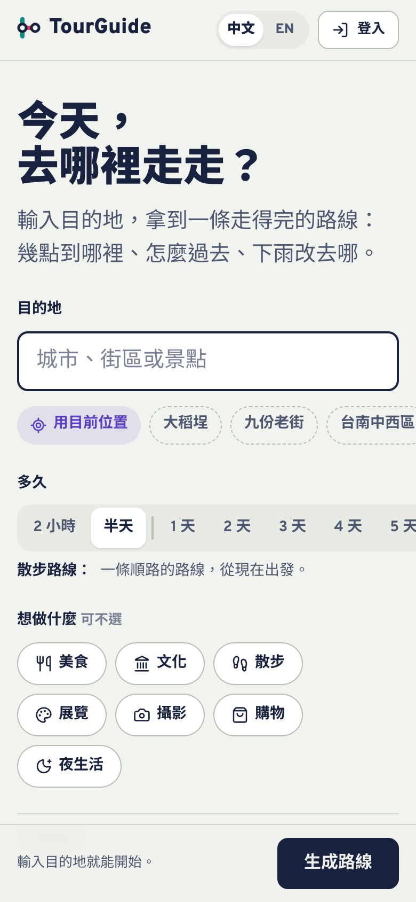
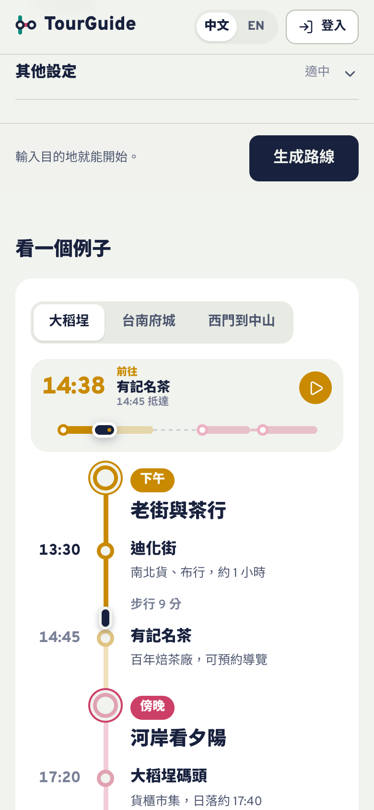
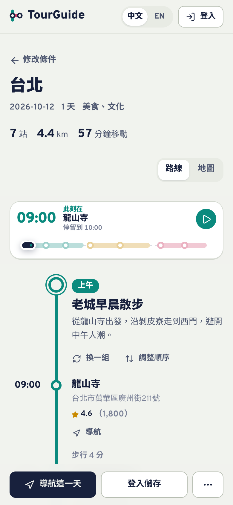
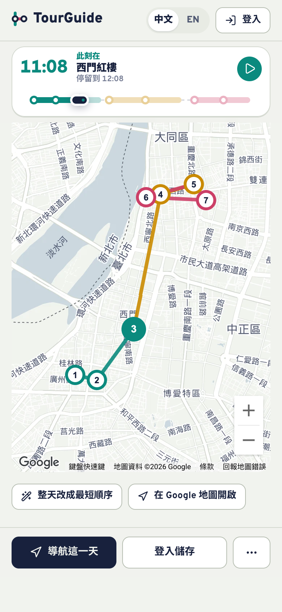

# TourGuide

**Turn a destination into a walkable, time-boxed itinerary, drawn as a transit line.**

[繁體中文](README.zh-TW.md) · [Live demo](https://tourguide-53562.web.app) · [Design notes](DESIGN.md)

<p>
  
  
  
  
</p>

Most itinerary apps give you a list. TourGuide gives you a **line**: each time of day (morning, afternoon, evening, night) is its own colour, stops are stations, and the walk between them is labelled with minutes and cost. Drag the train along the day to see where you will be at any moment.

## Features

- **One form for any outing.** Pick a destination and how long: 2 hours or half a day gives a single AI-planned walk; 1 to 7 days gives a day-by-day itinerary split by time of day.
- **Day scrubber.** A strip styled after the route display in a train car. Drag, tap a stop, or press play; the line and map follow. Keyboard accessible.
- **Grounded in real places.** For itineraries of one day or more, candidates come from Google Places and the LLM only chooses and orders them. Quick walks (2 hours, half a day) are written by the model directly, so check those stops before you go.
- **Fixes in place.** Swap a stop, redo one time slot or one day, reorder by drag or arrows, or re-sort a day by shortest walking distance.
- **Rain and crowd awareness.** Detects rain for your date and offers an indoor version; companion mode watches weather and crowds while you are out.
- **Stamps.** Check in at a stop with a note and photo and collect a stamp in your stamp book.
- **Save, share, export.** Save to your account, share a public link, export to PDF or Google Calendar, track spending against the estimate.
- **Installable PWA**, Traditional Chinese and English, light and dark themes.

## Tech stack

| Area | Choice |
| --- | --- |
| UI | React 19, TypeScript, Vite, hand-written CSS with design tokens |
| Routing | React Router 6 |
| Backend | Firebase: Auth (Google), Firestore, Storage, Hosting |
| Maps and places | Google Maps JavaScript API (Places, Geocoding, Directions, Distance Matrix) |
| AI | Groq chat completions (`openai/gpt-oss-120b`, set in `src/services/llm.ts`) |
| Weather | OpenWeatherMap (optional) |
| Export | jsPDF, html2canvas |

## Getting started

### Prerequisites

- Node.js 18 or newer
- A Firebase project with **Authentication (Google provider)**, **Firestore** and **Storage** enabled
- A Google Cloud API key with the Maps JavaScript API, Places API, Geocoding API, Directions API and Distance Matrix API enabled
- A [Groq](https://console.groq.com) API key
- Optional: an [OpenWeatherMap](https://openweathermap.org/api) API key

### Run it

```bash
git clone https://github.com/wenglien/TourGuide.git
cd TourGuide
npm install
cp .env.example .env   # then fill in your own keys
npm run dev
```

### Environment variables

All variables are read at build time by Vite and **end up in the browser bundle**; see [Security](#security).

| Variable | Required | Purpose |
| --- | --- | --- |
| `VITE_FIREBASE_API_KEY`, `VITE_FIREBASE_AUTH_DOMAIN`, `VITE_FIREBASE_PROJECT_ID`, `VITE_FIREBASE_STORAGE_BUCKET`, `VITE_FIREBASE_MESSAGING_SENDER_ID`, `VITE_FIREBASE_APP_ID` | yes | Firebase web app config (Project settings → Your apps) |
| `VITE_FIREBASE_MEASUREMENT_ID` | no | Analytics |
| `VITE_FIREBASE_VAPID_KEY` | no | Web Push public key; without it push notifications are off |
| `VITE_GOOGLE_MAPS_API_KEY` | yes | Maps, Places, geocoding and travel times |
| `VITE_GROQ_API_KEY` | yes | Route and itinerary generation |
| `VITE_OPENWEATHERMAP_API_KEY` | no | Rain detection; without it weather is skipped |

### Scripts

| Command | What it does |
| --- | --- |
| `npm run dev` | Start the dev server |
| `npm run build` | Type-check and build to `dist/` |
| `npm run preview` | Serve the production build locally |
| `npm run lint` | ESLint |
| `npm run deploy` | Build and deploy to Firebase Hosting (edit `.firebaserc` to point at your project) |

## Project structure

```
src/
  app/          App, shell (top bar), routes
  features/
    trip/       The single page: form, generating, result header
    plan/       Multi-day itinerary result and its state (usePlanner)
    walk/       Single-walk result
    route-line/ RouteLine diagram and DayScrubber
    stamps/     Stamp artwork
    trips/      "My trips": saved trips, stamp book, activity
    shared/     Public share page
  components/   Map, address autocomplete, budget tracker, reorder list
  services/     Google Maps, LLM, Firebase, weather, export, i18n
  ui/           Sheet, toast and confirm dialogs, segmented control
  styles/       Design tokens and base styles
```

Design decisions (colour tokens, type, motion rules) are in [DESIGN.md](DESIGN.md).

## Security

TourGuide is a client-side app, so anything prefixed `VITE_` is visible to every visitor. Before deploying publicly:

- **Restrict the Google Maps key** by HTTP referrer and to the APIs listed above.
- **Do not ship a Groq key you care about.** For production, move the LLM calls behind your own endpoint (for example a Cloud Function) and keep the key server-side. Until then, set a spending limit on the key.
- **Write Firestore and Storage security rules** so users can only read and write their own documents. Shared itineraries are the only public reads.
- Never commit `.env`. It is in `.gitignore`; `.env.example` lists the variable names only.

Found a vulnerability? Please open a private security advisory on GitHub rather than a public issue.

## Contributing

Issues and pull requests are welcome. Make sure `npm run build` passes (it type-checks) before opening a PR, and read [DESIGN.md](DESIGN.md) first if you are changing how something looks. `npm run lint` still reports older findings (mostly `any` types and hook dependency warnings); please don't add new ones, and cleaning them up is a good first contribution.

## License

[MIT](LICENSE)
