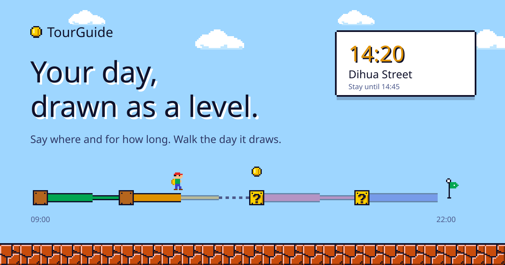
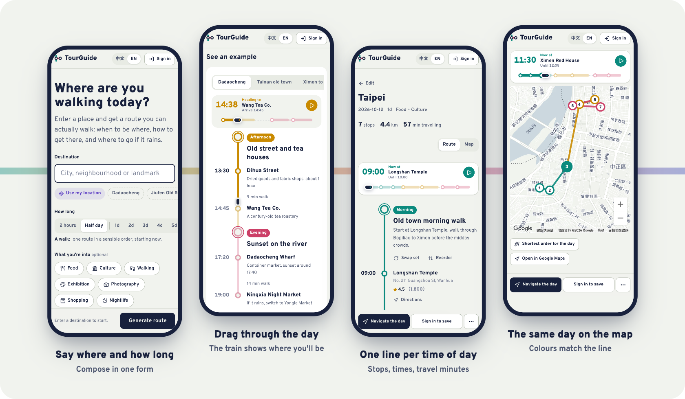
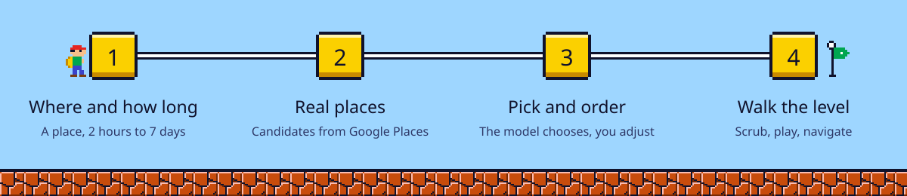

<div align="center">

<picture>
  <source media="(prefers-color-scheme: dark)" srcset="docs/assets/hero-en-dark.svg">
  
</picture>

<br>

[](https://tourguide-53562.web.app)
[](LICENSE)


**[Live demo](https://tourguide-53562.web.app)** &nbsp;·&nbsp; **[繁體中文](docs/README.zh-TW.md)** &nbsp;·&nbsp; **[Design notes](docs/DESIGN.md)**

</div>

<br>

Most itinerary apps hand you a list. TourGuide hands you a **line**.

Each time of day is its own colour, every stop is a station, and the walk between two stops is labelled with minutes and cost. Drag the little train along the day and the route and the map follow, so you always know where you will be at 14:20.

<div align="center">
<picture>
  
</picture>
</div>

<br>

<picture><source media="(prefers-color-scheme: dark)" srcset="docs/assets/divider-dark.svg"></picture>

## How it works

<picture>
  <source media="(prefers-color-scheme: dark)" srcset="docs/assets/how-en-dark.svg">
  
</picture>

How long decides the mode. **2 hours or half a day** gives a single walk written by the model. **1 to 7 days** gives a day-by-day itinerary: candidates come from Google Places, and the model only chooses and orders them. Walks are model-written, so check those stops before you go.

<picture><source media="(prefers-color-scheme: dark)" srcset="docs/assets/divider-dark.svg"></picture>

## What you get

<table>
<tr>
<td width="33%" valign="top"><b>One form, any outing</b><br>A place and how long. That is the whole input. Interests are optional; leave them empty for a balanced mix.</td>
<td width="33%" valign="top"><b>A day you can scrub</b><br>Drag anywhere on the strip, tap a stop, or press play. Releasing near a stop snaps to it. Fully keyboard accessible.</td>
<td width="33%" valign="top"><b>Quick starts</b><br>Use your location or tap a popular place such as Dadaocheng or Jiufen to fill in the destination.</td>
</tr>
<tr>
<td valign="top"><b>Fix things in place</b><br>Swap one stop, redo a time slot or a whole day, reorder by drag or arrows, or re-sort a day by shortest walk.</td>
<td valign="top"><b>Rain and crowds</b><br>Detects rain for your date and offers an indoor version. Companion mode watches weather and crowds while you are out.</td>
<td valign="top"><b>Stamps</b><br>Check in at a stop with a note and a photo, and collect a stamp in your stamp book.</td>
</tr>
<tr>
<td valign="top"><b>Save and share</b><br>Save to your account, share a public link, export to PDF or Google Calendar, and track spending against the estimate.</td>
<td valign="top"><b>Works without an account</b><br>Generating, scrubbing and navigating the day all work signed out. Sign in to save, share and stamp.</td>
<td valign="top"><b>Installable</b><br>A PWA in Traditional Chinese and English, with light and dark themes that follow your system.</td>
</tr>
</table>

<picture><source media="(prefers-color-scheme: dark)" srcset="docs/assets/divider-dark.svg"></picture>

## Run it yourself

You need Node.js 18 or newer, a Firebase project (Google sign-in, Firestore and Storage enabled), a Google Cloud API key, and a [Groq](https://console.groq.com) API key.

```bash
git clone https://github.com/wenglien/TourGuide.git
cd TourGuide
npm install
cp .env.example .env    # then fill in your own keys
npm run dev
```

<details>
<summary><b>Environment variables</b></summary>

<br>

Vite reads these at build time and they **end up in the browser bundle**. Read [Security](#security) first.

| Variable | Required | Purpose |
| --- | --- | --- |
| `VITE_FIREBASE_API_KEY`, `VITE_FIREBASE_AUTH_DOMAIN`, `VITE_FIREBASE_PROJECT_ID`, `VITE_FIREBASE_STORAGE_BUCKET`, `VITE_FIREBASE_MESSAGING_SENDER_ID`, `VITE_FIREBASE_APP_ID` | yes | Firebase web app config (Project settings → Your apps) |
| `VITE_FIREBASE_MEASUREMENT_ID` | no | Analytics |
| `VITE_FIREBASE_VAPID_KEY` | no | Web Push public key; without it push notifications are off |
| `VITE_GOOGLE_MAPS_API_KEY` | yes | Maps, Places, geocoding and travel times. Enable the Maps JavaScript, Places, Geocoding, Directions and Distance Matrix APIs |
| `VITE_GROQ_API_KEY` | yes | Route and itinerary generation |
| `VITE_OPENWEATHERMAP_API_KEY` | no | Rain detection; without it weather is skipped |

</details>

<details>
<summary><b>Scripts</b></summary>

<br>

| Command | What it does |
| --- | --- |
| `npm run dev` | Start the dev server |
| `npm run build` | Type-check and build to `dist/` |
| `npm run preview` | Serve the production build locally |
| `npm run lint` | ESLint |
| `npm run deploy` | Build and deploy to Firebase Hosting (point `config/.firebaserc` at your own project first) |

</details>

<details>
<summary><b>Tech stack and project structure</b></summary>

<br>

| Area | Choice |
| --- | --- |
| UI | React 19, TypeScript, Vite, hand-written CSS with design tokens |
| Routing | React Router 6 |
| Backend | Firebase: Auth (Google), Firestore, Storage, Hosting |
| Maps and places | Google Maps JavaScript API |
| AI | Groq chat completions; the model is set in `src/services/llm.ts` |
| Weather | OpenWeatherMap (optional) |
| Export | jsPDF, html2canvas |

```
src/
  app/          App, shell (top bar), routes
  features/
    trip/       The single page: form, generating, result header
    plan/       Multi-day itinerary result and its state (usePlanner)
    walk/       Single-walk result
    route-line/ RouteLine diagram and DayScrubber
    stamps/     Stamp artwork
    trips/      "My trips": saved trips, stamp book, activity
    shared/     Public share page
  components/   Map, address autocomplete, budget tracker, reorder list
  services/     Google Maps, LLM, Firebase, weather, export, i18n
  ui/           Sheet, toast and confirm dialogs, segmented control
  styles/       Design tokens and base styles
```

Colour tokens, type and motion rules are in [DESIGN.md](docs/DESIGN.md).

</details>

<picture><source media="(prefers-color-scheme: dark)" srcset="docs/assets/divider-dark.svg"></picture>

## Security

TourGuide is a client-side app, so anything prefixed `VITE_` is visible to every visitor. Before deploying publicly:

> [!WARNING]
> **Do not ship a Groq key you care about.** For production, move the LLM calls behind your own endpoint (for example a Cloud Function) and keep the key server-side. Until then, set a spending limit on the key.

- **Restrict the Google Maps key** by HTTP referrer and to the APIs listed above.
- **Write Firestore and Storage security rules** so users can only read and write their own documents. Shared itineraries are the only public reads.
- Never commit `.env`. It is in `.gitignore`; `.env.example` lists the variable names only.

Found a vulnerability? Please open a private security advisory on GitHub rather than a public issue.

## Contributing

Issues and pull requests are welcome. Make sure `npm run build` passes (it type-checks) before opening a PR, and read [DESIGN.md](docs/DESIGN.md) first if you are changing how something looks. `npm run lint` still reports older findings (mostly `any` types and hook dependency warnings); please don't add new ones, and cleaning them up is a good first contribution.

<br>

<picture><source media="(prefers-color-scheme: dark)" srcset="docs/assets/divider-dark.svg"></picture>

<div align="center">
<sub>MIT licensed. Made for slow days out.</sub>
</div>
