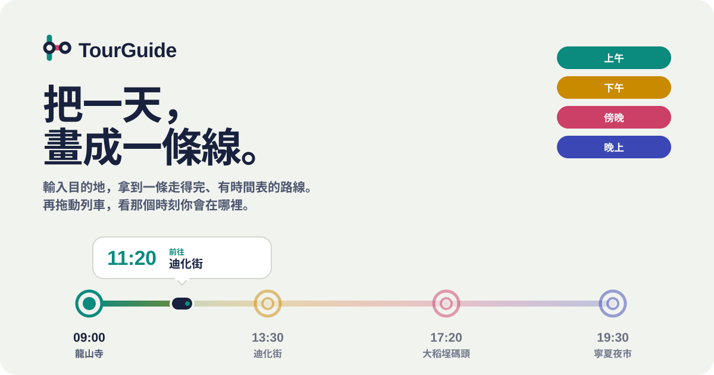

<div align="center">

<picture>
  <source media="(prefers-color-scheme: dark)" srcset="assets/hero-zh-dark.svg">
  
</picture>

<br>

[](https://tourguide-53562.web.app)
[](../LICENSE)


**[線上展示](https://tourguide-53562.web.app)** &nbsp;·&nbsp; **[English](../README.md)** &nbsp;·&nbsp; **[設計說明](DESIGN.md)**

</div>

<br>

多數行程規劃工具給你一份清單，TourGuide 給你一條**路線**。

上午、下午、傍晚、晚上各有一種顏色，每個景點是一個車站，站與站之間標著步行或搭車要幾分鐘、多少錢。拖動那台小列車，下方的路線和地圖會跟著動，一眼就知道下午 2 點 20 分你會在哪裡。

<div align="center">
<picture>
  
</picture>
</div>

<br>

<picture><source media="(prefers-color-scheme: dark)" srcset="assets/divider-dark.svg"></picture>

## 運作方式

<picture>
  <source media="(prefers-color-scheme: dark)" srcset="assets/how-zh-dark.svg">
  
</picture>

「多久」決定模式。**2 小時或半天**會排出一條由模型直接寫出的散步路線；**1 到 7 天**會排出每日行程：候選地點來自 Google Places，模型只負責挑選和排序。散步路線的景點是模型寫的，出發前請自行確認。

<picture><source media="(prefers-color-scheme: dark)" srcset="assets/divider-dark.svg"></picture>

## 功能

<table>
<tr>
<td width="33%" valign="top"><b>一張表單，所有行程</b><br>只要填地點和多久。興趣可以不選，不選就排綜合路線。</td>
<td width="33%" valign="top"><b>可以拖動的一天</b><br>在整條軌道上任一處拖動、點某一站，或按播放。放開時靠近某站會自動吸附。鍵盤也能完整操作。</td>
<td width="33%" valign="top"><b>快速開始</b><br>用目前位置，或點大稻埕、九份等熱門地點，一鍵填好目的地。</td>
</tr>
<tr>
<td valign="top"><b>就地調整</b><br>換掉一個景點、重排一個時段或一整天、拖曳或用箭頭調整順序，或一鍵改成最短步行順序。</td>
<td valign="top"><b>天氣與人潮</b><br>偵測當天是否下雨並提供室內版本；隨行模式會在外出時留意天氣與人潮。</td>
<td valign="top"><b>紀念章</b><br>在景點留下心得和照片，蓋一個紀念章收進紀念章冊。</td>
</tr>
<tr>
<td valign="top"><b>儲存與分享</b><br>存進帳號、產生公開分享連結、匯出 PDF 或 Google 日曆，並追蹤實際花費。</td>
<td valign="top"><b>不登入也能用</b><br>生成、拖動時間、導航整天都不需要帳號。登入後才能儲存、分享和蓋章。</td>
<td valign="top"><b>可安裝</b><br>PWA，支援繁體中文與英文，淺色與深色主題會跟著系統。</td>
</tr>
</table>

<picture><source media="(prefers-color-scheme: dark)" srcset="assets/divider-dark.svg"></picture>

## 自己跑起來

需要 Node.js 18 以上、一個 Firebase 專案（啟用 Google 登入、Firestore、Storage）、一組 Google Cloud API 金鑰，以及 [Groq](https://console.groq.com) API 金鑰。

```bash
git clone https://github.com/wenglien/TourGuide.git
cd TourGuide
npm install
cp .env.example .env    # 填入你自己的金鑰
npm run dev
```

<details>
<summary><b>環境變數</b></summary>

<br>

Vite 在建置時讀取這些變數，它們**會被打包進瀏覽器端的程式碼**，請先閱讀[安全注意事項](#安全注意事項)。

| 變數 | 必填 | 用途 |
| --- | --- | --- |
| `VITE_FIREBASE_API_KEY`、`VITE_FIREBASE_AUTH_DOMAIN`、`VITE_FIREBASE_PROJECT_ID`、`VITE_FIREBASE_STORAGE_BUCKET`、`VITE_FIREBASE_MESSAGING_SENDER_ID`、`VITE_FIREBASE_APP_ID` | 是 | Firebase 網頁應用程式設定（專案設定 → 你的應用程式） |
| `VITE_FIREBASE_MEASUREMENT_ID` | 否 | Analytics |
| `VITE_FIREBASE_VAPID_KEY` | 否 | 推播的公開金鑰；沒設定就不會啟用推播 |
| `VITE_GOOGLE_MAPS_API_KEY` | 是 | 地圖、地點搜尋、地理編碼與交通時間。需啟用 Maps JavaScript、Places、Geocoding、Directions、Distance Matrix |
| `VITE_GROQ_API_KEY` | 是 | 產生路線與行程 |
| `VITE_OPENWEATHERMAP_API_KEY` | 否 | 下雨偵測；沒設定就略過天氣 |

</details>

<details>
<summary><b>指令</b></summary>

<br>

| 指令 | 說明 |
| --- | --- |
| `npm run dev` | 啟動開發伺服器 |
| `npm run build` | 型別檢查並建置到 `dist/` |
| `npm run preview` | 在本機預覽正式版 |
| `npm run lint` | 執行 ESLint |
| `npm run deploy` | 建置並部署到 Firebase Hosting（請先把 `config/.firebaserc` 改成你的專案） |

</details>

<details>
<summary><b>技術與專案結構</b></summary>

<br>

| 項目 | 選擇 |
| --- | --- |
| 前端 | React 19、TypeScript、Vite、手寫 CSS 與設計 token |
| 路由 | React Router 6 |
| 後端 | Firebase：Auth（Google）、Firestore、Storage、Hosting |
| 地圖與地點 | Google Maps JavaScript API |
| AI | Groq；模型在 `src/services/llm.ts` 設定 |
| 天氣 | OpenWeatherMap（選用） |
| 匯出 | jsPDF、html2canvas |

```
src/
  app/          App、頂部列、路由
  features/
    trip/       唯一的主頁：表單、生成中、結果標頭
    plan/       多天行程結果與狀態（usePlanner）
    walk/       單次散步結果
    route-line/ 路線圖 RouteLine 與時間滑桿 DayScrubber
    stamps/     紀念章
    trips/      「我的旅程」：行程、紀念章冊、動態
    shared/     公開分享頁
  components/   地圖、地址自動完成、預算追蹤、排序清單
  services/     Google Maps、LLM、Firebase、天氣、匯出、i18n
  ui/           底部視窗、提示訊息與確認對話框、分段控制
  styles/       設計 token 與基礎樣式
```

配色、字型與動態的設計決策記錄在 [DESIGN.md](DESIGN.md)。

</details>

<picture><source media="(prefers-color-scheme: dark)" srcset="assets/divider-dark.svg"></picture>

## 安全注意事項

TourGuide 是純前端應用，所有 `VITE_` 開頭的變數，任何訪客都看得到。公開部署前請注意：

> [!WARNING]
> **別放你在意的 Groq 金鑰上線。** 正式環境請把 LLM 呼叫移到自己的後端（例如 Cloud Function），金鑰留在伺服器端。在那之前，請替金鑰設定用量上限。

- **限制 Google Maps 金鑰**：設定 HTTP 參照網址限制，並只開放上面列出的 API。
- **寫好 Firestore 與 Storage 安全規則**：使用者只能讀寫自己的資料，分享出去的行程是唯一的公開讀取。
- 不要提交 `.env`。它已在 `.gitignore` 中，`.env.example` 只列變數名稱。

發現安全問題？請在 GitHub 開一個私人的 security advisory，不要直接開公開 issue。

## 參與貢獻

歡迎提 issue 和 pull request。送出前請確認 `npm run build` 能通過（會做型別檢查）；如果要改外觀，請先讀 [DESIGN.md](DESIGN.md)。`npm run lint` 目前還有一些舊的問題（主要是 `any` 型別和 hook 依賴警告），請不要新增，順手清掉也非常歡迎。

<br>

<picture><source media="(prefers-color-scheme: dark)" srcset="assets/divider-dark.svg"></picture>

<div align="center">
<sub>MIT 授權。為悠閒的日子而做。</sub>
</div>
